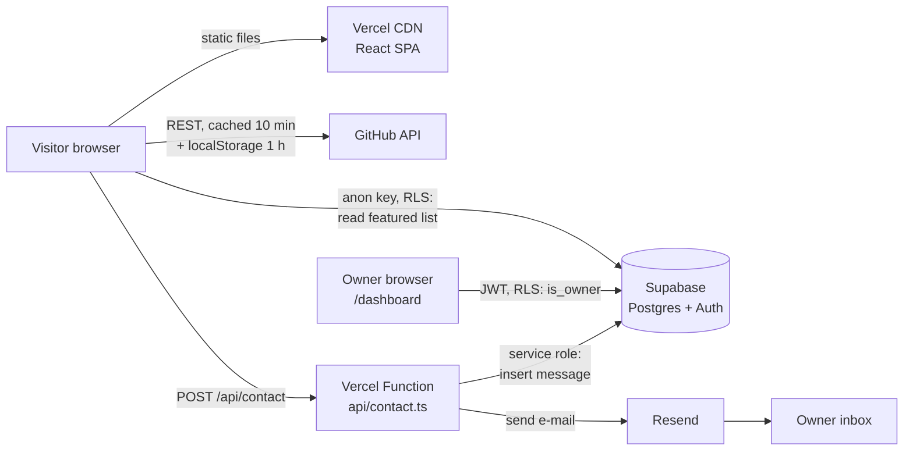
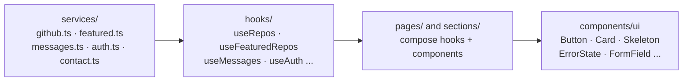
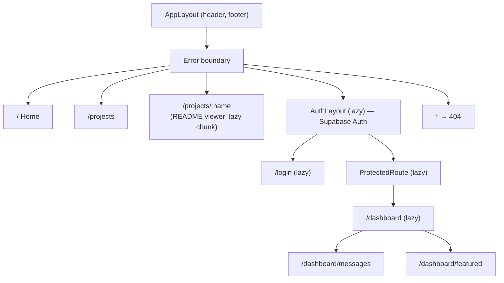
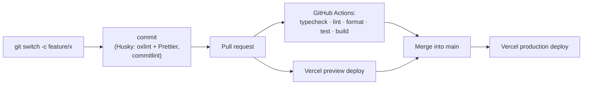

# Architecture

How the portfolio is put together, in diagrams. Every stack choice and its trade-offs are explained in [`PLAN.md`](PLAN.md).

## System overview



- Visitors never get write access to the database. Messages are inserted only by the server function, and its key never reaches the browser.
- The dashboard's data is protected twice: `ProtectedRoute` in the UI, and the `is_owner()` row-level security policy in the database.

## Data flow inside the app



| Layer                 | May do                                                                   | May not do                       |
| --------------------- | ------------------------------------------------------------------------ | -------------------------------- |
| `services/`           | `fetch`, Supabase calls, map API shapes to app types, throw typed errors | React, i18n                      |
| `hooks/`              | TanStack Query (cache keys in `queryKeys.ts`), context access            | `fetch` directly                 |
| `pages/`, `sections/` | Combine hooks and components; handle loading, error and empty states     | `fetch`, Supabase                |
| `components/ui/`      | Render props                                                             | Data hooks, translations, routes |

**How components are split:** a component goes in `ui/` when it knows nothing about the portfolio (it could live in any app). Domain pieces go in `projects/`, `sections/` or `dashboard/`. Routes go in `pages/`. If two places need the same markup, it moves down into `ui/` (for example `ErrorState`, used by projects, the README and the dashboard).

## Folder structure

```
api/                    Vercel Functions (server only)
  contact.ts            POST /api/contact → _lib/handleContact.ts
src/
  app/                  App, routes, providers, i18n, query client
  pages/                One component per route (+ dashboard/)
  components/
    ui/                 Generic, presentational
    layout/             Header, Footer, toggles, ProtectedRoute, AuthLayout
    sections/           Home page sections, contact form
    projects/           Cards, list states, README viewer
    dashboard/          Owner dashboard pieces
  hooks/                Data and state hooks + queryKeys.ts
  services/             The only code that talks to the network
  schemas/              Zod schemas (shared with api/)
  contexts/             Theme and auth
  content/en|pt/        Long content per language
  locales/              UI strings per language
supabase/migrations/    Versioned database schema and policies
```

## Routes and code splitting



The first load ships about 80 kB of gzipped JavaScript. Supabase, the contact form, the README renderer and everything under `/login` and `/dashboard` are separate chunks, downloaded only when needed.

## From branch to production



The AI follows the same path. `CLAUDE.md` describes the rules, and the `guard-git` hook blocks commits on `main` and `--no-verify`. Lint runs after every file the AI edits, and the `architecture-reviewer` agent checks the diff before each PR.
